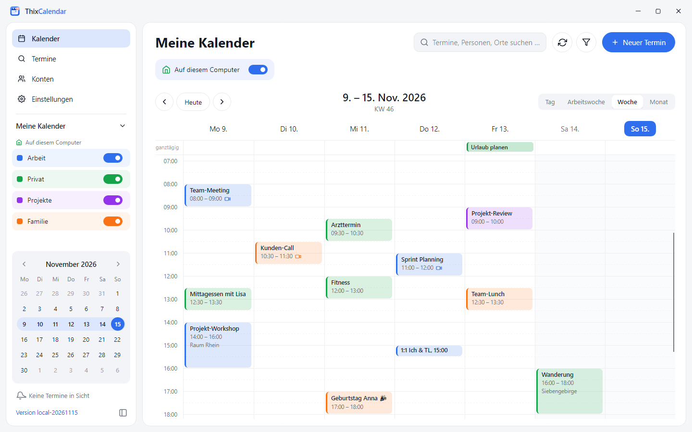
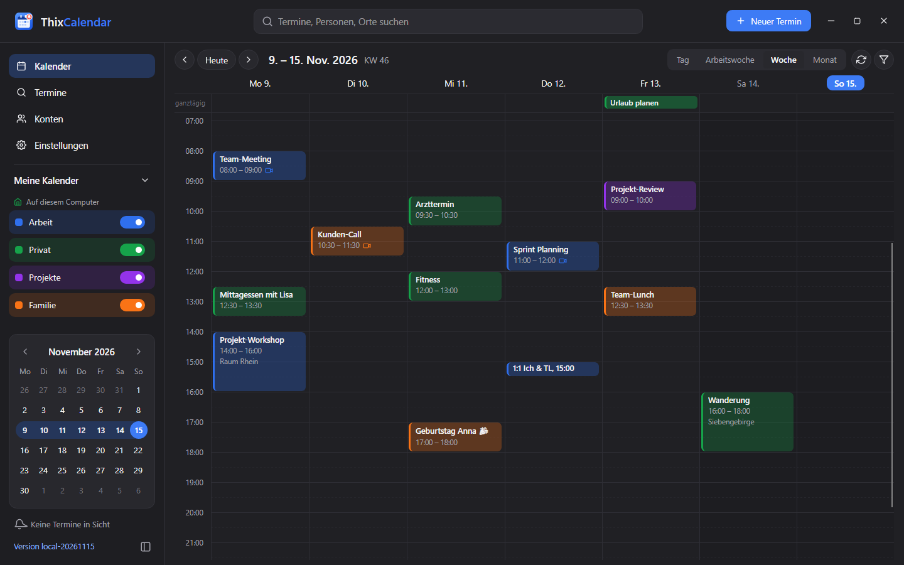
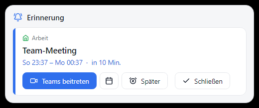
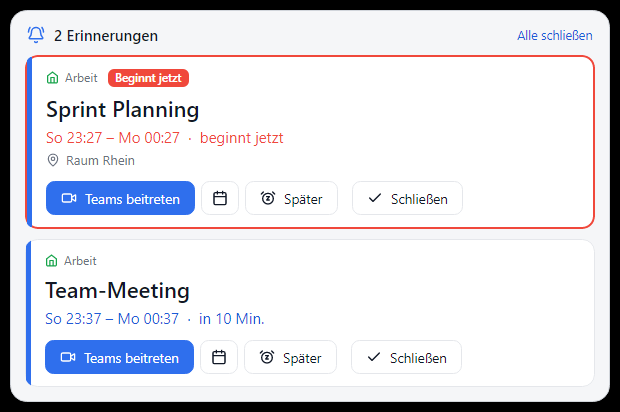
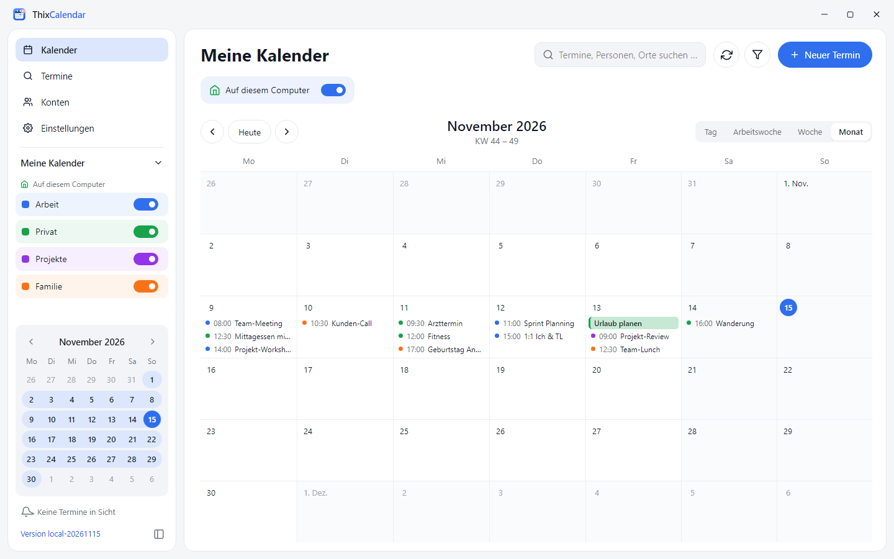
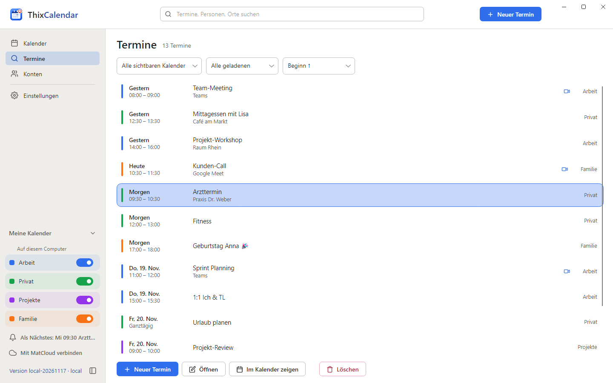
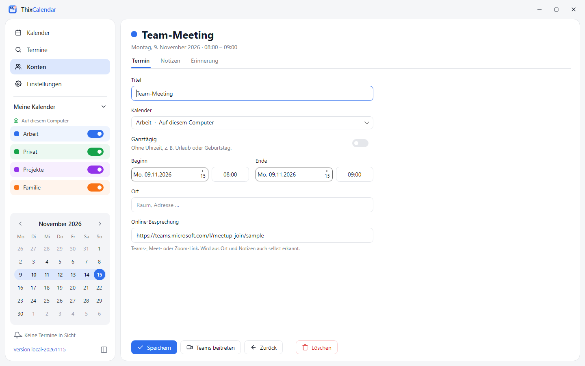
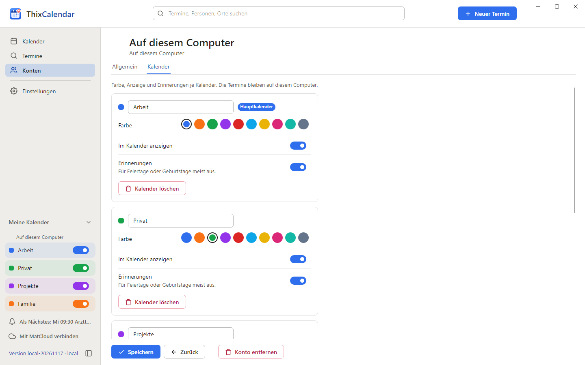
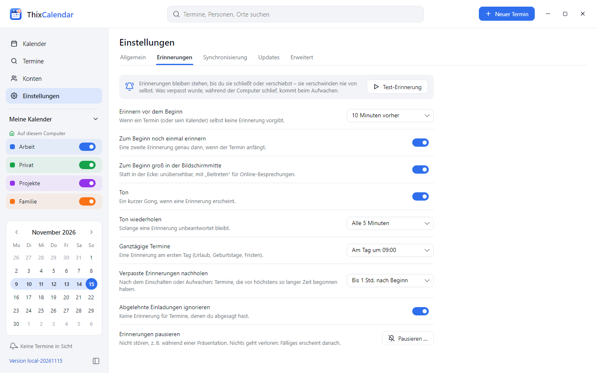
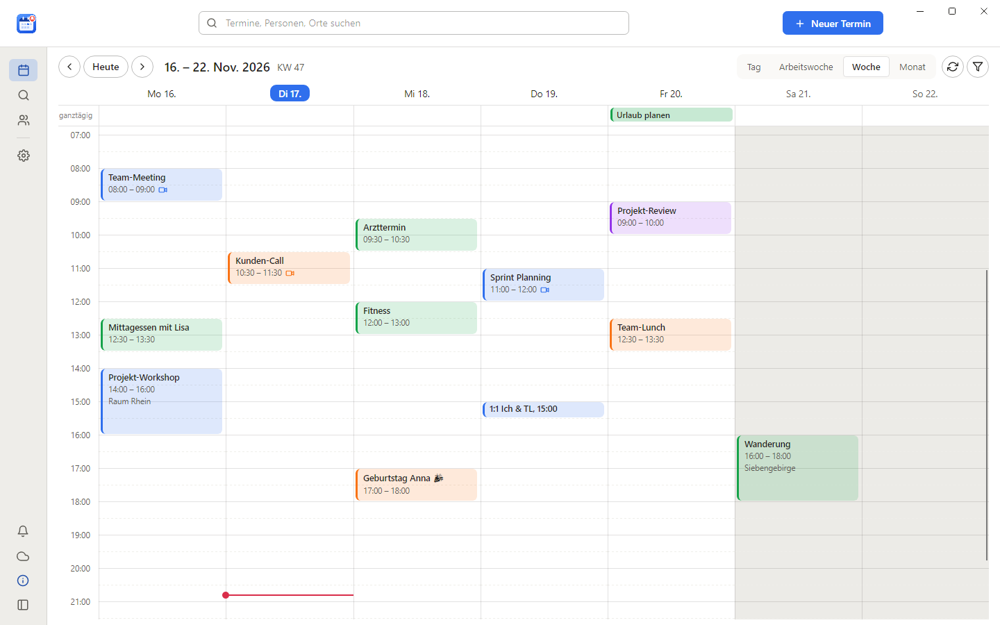

<p align="center"></p>

# ThixCalendar

**Alle Kalender an einem Ort – mit Erinnerungen, die man nicht verpasst.** Für Windows und macOS.

ThixCalendar bringt deinen **Microsoft-365-Kalender** (Arbeit), deinen **Google Kalender** (privat), abonnierte
**ICS-Adressen** (Feiertage, Schule, Verein) und **eigene Kalender** in einem Fenster zusammen – und sorgt
dafür, dass du keinen Termin mehr übersiehst.

| Woche (hell) | Woche (dunkel) |
|---|---|
|  |  |

## Auf allen Computern gleich – MatCloud und ThixLauncher

- **ThixLauncher** installiert ThixCalendar mit einem Klick, hält es aktuell und meldet es gleich bei deiner **MatCloud** an.
- **MatCloud** (die Cloud der Thix-Apps) gleicht ab: deine Konten, die eigenen Kalender mit ihren Terminen, die Einstellungen der
  Erinnerungen und **deine Antworten auf Erinnerungen** – schließt du eine Erinnerung am Laptop, ist sie auch am Desktop erledigt.
- **Anmeldungen bei Microsoft und Google bleiben auf jedem Computer für sich**: Ein Konto, das von einem anderen Computer kommt,
  zeigt „Anmeldung nötig“ – einmal „Neu anmelden“, fertig.
- Ohne Launcher: Einstellungen › Cloud › *Im Browser anmelden* (oder mit Benutzername und Passwort).

## Erinnerungen, die man nicht übersieht

Der Grund, warum es ThixCalendar gibt:

- **Bleiben stehen**, bis du sie beantwortest – *Schließen*, *Später …* oder *Beitreten*. Nichts verschwindet nach ein
  paar Sekunden im Benachrichtigungscenter.
- **Immer obenauf**, ohne dir die Tastatur wegzunehmen: Die Erinnerung liegt über allen Fenstern (auch über dem
  „Nicht stören“ von Windows), du tippst trotzdem weiter, wo du warst.
- **Zweimal**: zur Vorlaufzeit (die des Termins, sonst die des Kalenders, sonst deine Einstellung – Standard 10 Minuten)
  und **noch einmal zum Beginn** – dann **groß in der Bildschirmmitte** mit rotem „Beginnt jetzt“.
- **Ein Klick in die Besprechung**: Teams-, Meet-, Zoom- und Webex-Links werden erkannt (auch in Ort und Notizen);
  „Teams beitreten“ öffnet sie und erledigt die Erinnerung.
- **Ton**, auf Wunsch **wiederholt** (Standard: alle 5 Minuten), solange niemand reagiert.
- **Verpasst, während der Computer schlief?** Beim Aufwachen kommt die Erinnerung trotzdem – solange der Termin läuft
  (bis 1 Std. nach Beginn, einstellbar).
- **Später** mit Sinn: 1 – 60 Minuten, „bis zum Beginn“, „5 Min. vor Beginn“; der Beginn bricht jede Verschiebung.
- **Nicht stören** (Tray oder Einstellungen): 30 Min. bis morgen früh – was in der Zeit fällig wird, erscheint danach.
- **Ganztägige Termine** erinnern am ersten Tag (Standard 09:00); abgelehnte Einladungen und abgesagte Termine nicht.
- Das **Tray-Symbol** trägt einen roten Punkt, solange etwas offen ist; sein Tooltip nennt den nächsten Termin.

| In der Ecke | Zum Beginn in der Bildschirmmitte |
|---|---|
|  |  |

## Kalender

- **Tag, Arbeitswoche, Woche, Monat** wie im Mockup ([docs/mockups/hauptfenster.png](docs/mockups/hauptfenster.png)):
  aufgebaut wie ThixClip (Kopfzeile mit Suche und „Neuer Termin“, Seitenleiste mit Trennlinie); der Kalender bekommt
  den Platz – darüber nur eine schmale Leiste (‹ Heute ›, Zeitraum mit KW, Ansicht, Synchronisieren, Filter für Konten
  und Kalender). „Meine Kalender“ mit farbigen Schaltern und der kleine Monat in der Seitenleiste, heute als blaue
  Pille, eine rote Linie für „jetzt“, überlappende Termine nebeneinander.
- **Termine anlegen, ändern, löschen** – auch direkt in Microsoft 365 und Google (lokal gespeichert wird erst, was der
  Anbieter angenommen hat). Doppelklick auf freie Zeit legt dort einen Termin an.
- **Termine** (Liste): die Suche oben im Fenster findet Titel, Ort, Notizen, Personen und Kalender; Filter nach Kalender und Zeitraum,
  Sortierung, Seiten; darunter *Neuer Termin*, *Öffnen*, *Beitreten*, *Im Kalender zeigen* … *Löschen*.
- **Konten**: verbinden, Farbe / Anzeige / Erinnerungen je Kalender, neu anmelden, synchronisieren, entfernen.
- Hell / dunkel / wie das System, einklappbares Menü (`Strg/⌘ + B`).

| Monat | Termine | Termin bearbeiten |
|---|---|---|
|  |  |  |

| Konto & Kalender | Einstellungen › Erinnerungen | Menü eingeklappt |
|---|---|---|
|  |  |  |

## Bedienung per Tastatur

| Taste | Wirkung |
|---|---|
| `←` `→` | vorheriger / nächster Zeitraum |
| `T` | heute |
| `D` / `A` / `W` / `M` | Tag / Arbeitswoche / Woche / Monat |
| `Strg/⌘ + N` | neuer Termin (nächste volle Stunde des gezeigten Tags) |
| `Strg/⌘ + F` | in die Suche (findet alle Termine) |
| `Strg/⌘ + 1 / 2 / 3` | Kalender / Termine / Konten |
| `Strg/⌘ + ,` | Einstellungen |
| `Strg/⌘ + B` | Menü ein- / ausklappen |
| `Esc` | im Editor: zurück |
| `↑` `↓` in einer Uhrzeit | ±15 Minuten (Uhrzeiten tippt man wie auf Papier: `9`, `930`, `9:30`, `14.45`) |

Die Versionsnummer unten links öffnet „Über ThixCalendar“; liegt ein Update bereit, steht es dort.

## Installation

**Windows** – `ThixCalendarSetup.exe` aus dem [Release-Kanal](https://github.com/Real-TTX/ThixCalendar/releases/tag/release-channel)
starten. Installiert pro Benutzer nach `%LocalAppData%\Programs\ThixCalendar` (ohne Administratorrechte), mit
Startmenü, „Installierte Apps“, Autostart, optional Desktop-Verknüpfung und automatischen Updates (vorausgewählt).
Deinstallieren über „Installierte Apps“ (auf Wunsch samt Daten).

**macOS** – `ThixCalendar-macOS-arm64.dmg` (Apple Silicon) bzw. `-x64.dmg` (Intel) öffnen und ThixCalendar in
„Programme“ ziehen. Die App ist ad hoc signiert: beim ersten Start Rechtsklick › Öffnen. Autostart unter
Einstellungen › Allgemein (LaunchAgent).

Das Fenster zu schließen beendet ThixCalendar **nicht** – es erinnert weiter aus dem Infobereich / der Menüleiste.
Beenden über das Tray-Menü.

## Konten verbinden

Unter **Konten › Konto hinzufügen**:

| Art | Wie | Lesen / Schreiben |
|---|---|---|
| **Microsoft 365 / Outlook.com** | Anmeldung im Browser (Microsoft Graph) | ✔ / ✔ |
| **Google Kalender** | Anmeldung im Browser (Google Calendar API) | ✔ / ✔ |
| **ICS-Abo** | Kalenderadresse (`https://…` oder `webcal://…`) | ✔ / – |
| **Eigene Kalender** | – (mit MatCloud auf allen Computern) | ✔ / ✔ |

Die Anmeldung läuft im **eigenen Browser** (OAuth 2.0 mit PKCE, Antwort über eine Loopback-Adresse): ThixCalendar sieht
dein Passwort nie. Gespeichert wird nur das Refresh-Token – unter Windows mit DPAPI verschlüsselt, unter macOS im
Schlüsselbund. Abgeglichen werden alle 5 Minuten (einstellbar) zwei Wochen zurück und vier Monate voraus; andere
Zeiträume, sobald du sie ansiehst. Ohne Netz bleiben Termine und Erinnerungen erhalten.

### Anmeldung bei Microsoft und Google

Du meldest dich einfach mit deinem Entra-/Microsoft- bzw. Google-Konto an – nichts weiter einzutragen. Dafür bringt
ThixCalendar seine eigene App-Registrierung bei Microsoft und Google mit; der Herausgeber legt sie **einmalig** an und
baut sie über Repository-Secrets ein: [docs/APP-REGISTRIERUNG.md](docs/APP-REGISTRIERUNG.md). Nur Firmen, die fremde
Apps sperren, können unter Einstellungen › Erweitert eine eigene Registrierung eintragen.

Ganz ohne Registrierung geht es lesend über **ICS**: Google Kalender › Einstellungen › *Privatadresse im iCal-Format*;
Outlook › Einstellungen › Kalender › Freigegebene Kalender › *Kalender veröffentlichen* › ICS-Link.

## Updates

- **OTA**: kurz nach dem Start und alle 6 Stunden schaut ThixCalendar im eigenen Kanal nach (GitHub-Releases
  `release-channel` bzw. `nightly-channel`, Manifest `thixcalendar-update.json` mit SHA-256 je Paket).
- **Full-Auto-Update** (Standard, abschaltbar): neue Versionen werden ohne Rückfrage installiert, ThixCalendar startet
  danach wieder im Infobereich. Sonst bietet es Tray und Einstellungen › Updates an.
- Lokale Builds aktualisieren sich nie.

## Versionen, Branches, CI

| Branch | Kanal | Version | Beispiel |
|---|---|---|---|
| `main` | Release | `<major>.<minor>.<build>-<datum>` | `0.1.42-20261115` |
| `dev` | Nightly | `nightly-<build>-<datum>` | `nightly-43-20261115` |
| andere / lokal | Local | `local-<datum>` | `local-20261115` |

Die Build-Nummer ist die fortlaufende Nummer des Workflows. `.github/workflows/desktop.yml` baut, testet und paketiert
auf **jedem Branch** (Windows: Tests, getrimmtes Single-File `ThixCalendarSetup.exe` + Selbsttest; macOS: Tests,
`.app` → `.dmg`/`.zip` für arm64 und x64). `main` veröffentlicht in den Release-Kanal und als `v<version>`, `dev` in den
Nightly-Kanal; jede Ausführung legt die Pakete als Artefakt ab. Optionale Repository-Secrets für eingebaute
App-Registrierungen: `THIXCALENDAR_MICROSOFT_CLIENT_ID`, `THIXCALENDAR_GOOGLE_CLIENT_ID`, `THIXCALENDAR_GOOGLE_CLIENT_SECRET`.

## Für Administratoren

Richtlinien (Wert 1 = an) unter `HKLM\SOFTWARE\Policies\ThixCalendar` (Windows) bzw. als Profil für
`info.schmoldt.thixcalendar` (macOS):

| Richtlinie | Wirkung |
|---|---|
| `LockConfiguration` | Einstellungen und Konten nur lesbar (Kalender und Erinnerungen bleiben nutzbar) |
| `DisableOnlineAccounts` | keine Microsoft-, Google- oder ICS-Konten – nur eigene Kalender |
| `DisableUpdates` | keine Update-Prüfung und -Installation |
| `DisableCloud` | keine Verbindung zur MatCloud |

## Entwicklung

```
dotnet build ThixCalendar.slnx                       # 0 Warnungen, 0 Fehler
dotnet test tests/ThixCalendar.Tests                 # Business-Layer, Provider, OAuth-Loopback, UI headless
THIXCALENDAR_SCREENSHOTS=<ordner> dotnet test …      # dazu Screenshots jeder Seite (hell und dunkel)
THIXCALENDAR_DATA_DIR=<ordner> THIXCALENDAR_SAMPLE_DATA=1 dotnet run --project src/ThixCalendar   # eigene Instanz mit Beispielwoche
dotnet publish src/ThixCalendar -c Release -r win-x64 -o publish && publish/ThixCalendar.exe --self-test report.txt
cd tools && npm install && node render-icons.js      # Logo → PNG/ICO (installierter Edge, headless)
```

Aufbau, Regeln und Konventionen: [CLAUDE.md](CLAUDE.md). Logo und Detailstufen: [branding/README.md](branding/README.md).

© Matthias Schmoldt
